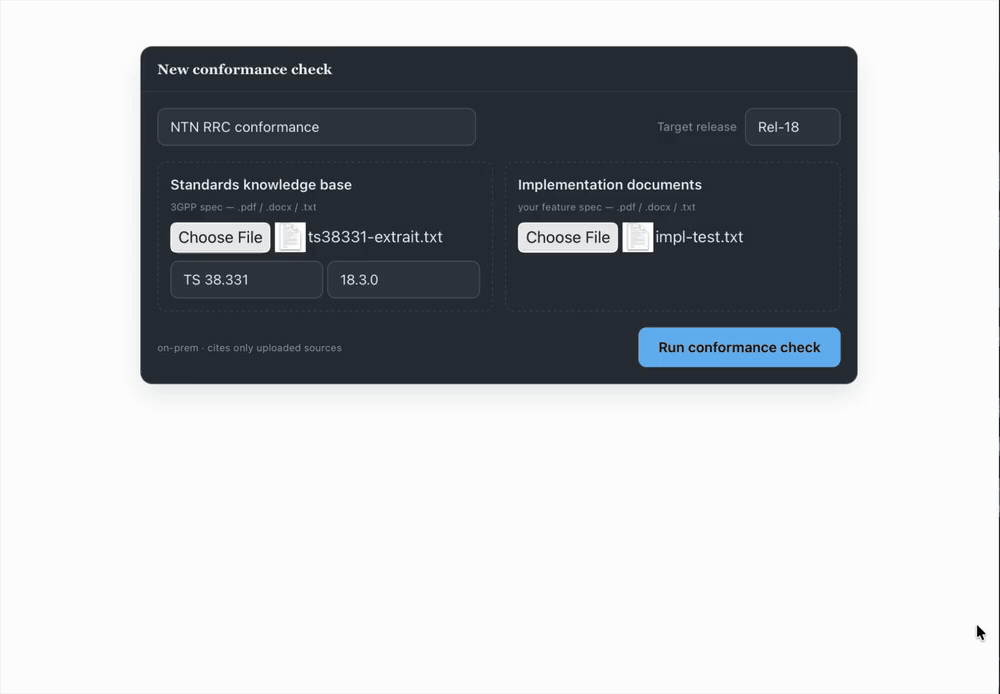

# Spec Conformance Agent (agentic stack)

 

A 3GPP/O-RAN **document-level** conformance engine on a full modern agentic-SaaS
stack. **Every tool has an explicit, working role**, nothing is a placeholder.
The moat modules (`lib/parser-3gpp.ts`, `lib/conformance-contract.ts`) are
stack-agnostic; everything else is built on this stack.

## Problem

Verifying a device implementation against a 3GPP specification is manual and slow:
an engineer cross-reads thousands of clauses to judge whether each requirement is met.
This tool produces that first pass automatically, it ingests the spec plus the
implementation docs and returns an auditable **conformance matrix** where every verdict
cites the exact governing clause.

## Every tool → its role

| Tool | Role in THIS product | Real? |
|---|---|---|
| **Next.js 15** | App framework (UI + API routes) | implemented |
| **Clerk** | Auth + multi-tenancy (Organization = tenant) | implemented |
| **PostgreSQL + Prisma** | Relational store (runs, requirements, assets) | implemented |
| **Qdrant** | Vector store for the vector fallback | implemented |
| **Neo4j** | Clause cross-reference graph (vectorless graph-walk) | implemented |
| **OpenRouter** | LLM gateway (agent calls + embeddings) | implemented |
| **LangGraph** | Bounded pipeline as a state machine | implemented |
| **LangChain** | LLM / embeddings / store plumbing | implemented |
| **Cloudinary** | Raw uploaded-document storage | implemented |
| **Vidimus** | Empirically calibrated confidence (tranche accuracy + Wilson 95 % interval, 40 items from the 40-item gold set, two v2 runs, one model; only the top tranche has at least 10 items (94.2 % observed accuracy, Wilson 95 % [78–99]), the rest go to human review — see [EVAL.md](EVAL.md#confidence-calibration)) + Ed25519-signed attestation (sidecar). Raw LLM confidence is **not** calibrated (R10: a wrong verdict at 0.95). | implemented using [kabNath/vidimus](https://github.com/kabNath/vidimus) |
| **Docker** | Local parity (docker-compose) + on-prem deliverable | Dockerfiles |
| **CI/CD** | GitHub Actions: ci.yml (node + vidimus-svc checks); deploy.yml (manual, workflow_dispatch) | real, OIDC |
| **AWS** | App Runner (app + vidimus) + RDS Postgres, via Terraform | IaC in infra/terraform |

**Retrieval:** vectorless clause-graph navigation over Neo4j as the primary path, with Qdrant vector similarity as a fallback, not naïve chunk-and-embed RAG.

## Architecture

Next.js 15 (UI + API) with Clerk auth (orgId = tenant) drives a LangGraph state
machine: `extract -> ( retrieve -> compile )* -> END` (the deterministic shell).
- retrieve: vectorless graph-walk on Neo4j + Qdrant fallback (bounded)
- assess: verdict + confidence, grounded only in the cited clause
- verify: adversarial check (catches citation hallucination)
- guards (deterministic, before any LLM verdict is committed): the assessor's supporting excerpt must appear **verbatim** (whitespace-normalised, at least 4 words) in the ingested clause, else the verdict is forced to `insufficient_evidence` (`citation_not_verbatim` if absent from the clause, `citation_too_short` if exact but under the minimum); a `gap` may only commit if the excerpt has a shall/must sentence about the requirement's subject (`gap_not_grounded`) **and** a verifier from another model family agrees. Set `OPENROUTER_VERIFIER_MODEL` (e.g. a non-Anthropic model when the assessor is Anthropic); unset or same family ⇒ gaps are routed to human review (`verifier_same_family`)
- compile: Vidimus attest -> tranche-accuracy confidence (`calibrated: false`, no interval, when the tranche has < 10 reference items) + signed proof
Persistence: Prisma/PostgreSQL (matrix rows), Cloudinary (blobs), Vidimus (attestations).

## Run locally

    docker compose up -d                 # postgres + qdrant + neo4j + vidimus
    cp .env.example .env.local           # fill Clerk / OpenRouter keys
    npm install
    npx prisma migrate dev --name init
    npm run ingest -- <orgId> ts38331 "TS 38.331" 18.3.0 Rel-18 examples/ts38331-extrait.txt
    npm run dev                          # http://localhost:3000

## Expected behaviour

What you will see on a run, and why. None of it is a bug; the numbers come from [EVAL.md](EVAL.md) (v2, two passes over the 40-requirement gold set, 95 % Wilson intervals per pass; these requirements were already seen while the guards were designed, see its "Limites" section).

- **Requirements are reformulated.** The extraction step rewrites each requirement of your document in the normative form: "applies" becomes "the terminal **shall** apply", and the trigger of a compound sentence ("When a session is opened, …") is repeated in every piece. The matrix therefore shows the reformulated sentence, not a quotation of your document; the source sentence is recorded in the row (`source.section`).
- **Compound sentences are split.** One sentence with several actions becomes several rows (the demo document has 5 sentences and produces 11 rows). In the one demo document audited so far, nothing was merged, duplicated, invented or omitted; that is a single document, and how often the extraction does otherwise (including turning a non-requirement sentence into a row) is what `scripts/eval-extraction.ts` is meant to measure. It has not been run yet.
- **"insufficient" appears as "needs review".** A row without enough evidence (no clause found, a guard that refused to commit, a verifier that disagrees) has the verdict *insufficient evidence* and is listed under **needs review**. The summary counts "needs review", not a separate "insufficient" figure, and a row in review shows its reason in full instead of a confidence percentage.
- **A large share goes to human review.** On the gold set, **18/40 = 45.0 % [31–60]** and **17/40 = 42.5 % [29–58]** requirements were sent to review in the two passes (about 4 in 10), and **22/40 = 55.0 % [40–69]** and **23/40 = 57.5 % [42–71]** were committed. Most reviews come from retrieval finding no clause (8 per pass), then low confidence (3–4), then guards refusing a gap or a citation. This is the intended trade: among committed verdicts the observed accuracy was 21/22 = 95.5 % [78–99] and 22/23 = 95.7 % [79–99], at the price of coverage. These are small samples (the two passes score the same 40 items), so treat the intervals as wide.
- **Confidence is calibrated only in the top band.** A committed row shows "calibrated confidence X% (interval) — observed accuracy on N items of this tranche"; below 10 reference items the confidence is not calibrated and the row goes to review.

## Deploy to AWS

The infrastructure is real Terraform plus an OIDC deploy workflow. Deployment
requires AWS credentials: run `terraform apply`, then add the GitHub secrets.

    # 1. Provision AWS (ECR, App Runner x2, RDS, GitHub OIDC role); point at
    #    managed Qdrant Cloud / Neo4j Aura endpoints.
    cd infra/terraform
    cp terraform.tfvars.example terraform.tfvars   # fill in the values
    terraform init && terraform apply
    #    -> outputs: app_url, ecr repos, github_deploy_role_arn, db_address

    # 2. In GitHub repo settings add:
    #    Variables: AWS_REGION
    #    Secrets:   AWS_DEPLOY_ROLE_ARN (=github_deploy_role_arn),
    #               APPRUNNER_APP_ARN, APPRUNNER_VIDIMUS_ARN

    # 3. Run the deploy workflow manually (deploy.yml, workflow_dispatch): it
    #    builds and pushes both images to ECR and starts App Runner. The app is
    #    then live at app_url.

End-to-end deploy: OIDC (no long-lived keys), ECR, App Runner, RDS, no stubs.
`terraform apply` and the GitHub secrets require an AWS account.

## Evaluation

[`eval/gold-set.json`](eval/gold-set.json) is a **40-item expert-validated benchmark for
document-level 3GPP conformance** — atomic requirements over a 266-clause TS 38.331 v19.3.0
extract, each with a human-validated verdict (17 conformant / 16 gap / 7 insufficient) and
governing clause, tagged easy/medium/hard. Reference verdicts are human-validated in a
four-batch protocol; the same model is never both examinee and examiner. Scored by
[`scripts/eval.ts`](scripts/eval.ts). Full methodology, failure analysis, and a two-run
stability study are in **[EVAL.md](EVAL.md)**.

Headline numbers, v1 vs v2 (`claude-sonnet-4.6` assessor, temp 0; two passes each over the same 40 items, so the passes are not independent; full table with 95 % Wilson intervals in [EVAL.md](EVAL.md#headline-v1-vs-v2)):

| metric | v1 (run 1 / run 2) | v2 (pass 1 / pass 2) |
|---|--:|--:|
| Accuracy over all 40 items (system errors count as failures) | 67.5 % / 62.5 % | 65.0 % / 67.5 % |
| **Committed accuracy** (correct when it commits) | 21/24 = 87.5 % / 19/22 = 86.4 % | 21/22 = 95.5 % / 22/23 = 95.7 % |
| **Coverage** (committed / scored) | 63.2 % / 59.5 % | 55.0 % / 57.5 % |
| Silent errors (committed and wrong) | 3 / 3 | 1 / 1 |
| Items routed to human review | 14 / 15 | 18 / 17 |
| System errors | 2 / 3 | 0 / 0 |

How to read it, without spin: **overall accuracy did not improve** (about 66 % in both versions). What changed is that v2 is right about 95 % of the time *when it commits a verdict*, and in exchange it abstains on roughly 43-45 % of the requirements and routes them to a human reviewer. The v2 gain comes from abstention, not from being more right. Conformant recall fell (11/17 in v2 against 15/17 and 14/17 in v1, see [EVAL.md](EVAL.md#what-got-worse-conformant-items)). Calibration (EVAL.md "Confidence calibration — recomputed"): ECE 0.132 for the raw confidence, 0.003 after 5-fold cross-validated calibration; only the top tranche [0.8, 1.0] (26 items, 94.2 % observed accuracy, Wilson 95 % [78.4–98.7]) reaches 10 items, so the other predictions are answered `calibrated: false` and routed to review.

Limits: the 40 items were seen while the v2 guards were designed, so this set cannot be used again to tune; one model, one TS 38.331 extract; the extraction step has not been evaluated yet (`scripts/eval-extraction.ts` was never run, so there is no extraction number). v1 diagnosis still holds: retrieval, not judgement, is the bottleneck (verdict accuracy given the right clause 92.3 % / 92.0 %, given the wrong clause 25.0 % / 16.7 % in v1; EVAL.md).

The dominant error mode is a **conservative bias**: when retrieval can't ground a `gap`, the system returns `insufficient` and routes to review rather than asserting a verdict it can't cite. That costs `gap` recall (50.0 % and 56.2 % in v2) but no false gap was committed in either v2 pass (0/17, Wilson 95 % upper bound 18 %), which is the right direction to be wrong in for a tool whose verdicts carry liability.

## Honest status

- Implemented and defensible line-by-line: the LangGraph pipeline, the vectorless
  Neo4j graph-walk with Qdrant fallback, the adversarial verifier, the 3GPP parser,
  multi-tenant SaaS, the full UI, the Vidimus attestation service, the Terraform IaC,
  and the OIDC deploy workflow.
- Going live requires AWS credentials: `terraform apply` against an AWS account plus
  the GitHub secrets. Until then the system is complete but not on a live URL.
- Evaluation: measured against a 40-item expert-validated benchmark (already seen during
  guard design) — see the [Evaluation](#evaluation) section and [EVAL.md](EVAL.md). In v2,
  committed verdicts are 95.5-95.7 % accurate at 55-58 % coverage; overall accuracy is
  unchanged (~66 %). No extraction numbers yet.
- Polyglot persistence is a deliberate architecture choice: Neo4j is the central
  technical fit (clause-graph navigation), Qdrant is a fallback only, and Postgres
  holds relational run/matrix data.
